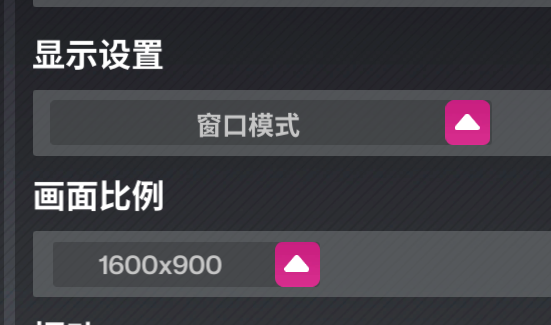
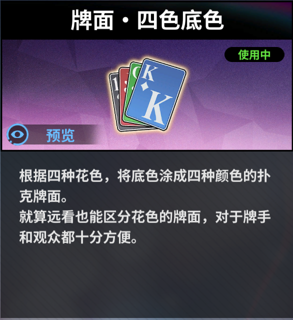

# 德扑助手 · Poker Assistant

> **免责声明：** 本项目仅供学习研究，不涉及商业利益；**不保证识别准确、策略最优或盈利**。请遵守当地法律及平台规则，自行承担使用风险。软件按现状提供，条款见 [LICENSE](LICENSE)；如有侵权，请联系处理。

面向 Poker Fate 的 Windows 本地助手，识别筹码、下注、底池、盲注及牌面，显示动作建议和 EV。

**[下载安装包](https://github.com/Sleepearlyy/poker-assistant/releases/latest)**，运行 `.exe` 安装，已有版本可覆盖升级。

## 使用要求

- Windows 10/11 x64，无需 Python、Conda 或独立显卡。
- 游戏设为 **窗口模式、1600×900**，牌面使用 **「牌面·四色底色」**，如下图。
- 少人局保留空座。支持普通金额、K/M 和 BB 显示。
- 保持游戏可见，收起下注面板，等待动画结束后识别。

 

## 操作

1. 打开游戏和助手，自动定位游戏窗口；在 **更多 → 定位游戏** 中预览截图。
2. 轮到自己时按 **A** 或点击“识别”，每次读取一帧；按 **Q** 收起。
3. “牌桌”查看各家筹码与动作，“动作 EV”查看候选动作；**更多 → 计算依据** 查看范围假设。

## 注意事项

- 当前为早期版本，遮挡或动画可能造成误读，请核对牌面与金额。预选按钮不代表轮到自己行动。
- A/Q 仅在游戏或助手位于前台时生效，可能影响打字。
- K/M、BB 受游戏显示精度限制；复杂边池、抽水及锦标赛 ICM 未完整建模。
- 全部计算在本机完成，不上传截图、不自动下注。记录保存在 `%LOCALAPPDATA%\PokerScreenReader`。
- 安装包未商业签名，Windows 可能提示“未知发布者”；请从本仓库 Releases 下载。

## 算法

系统由视觉识别、状态重建、对手范围先验和决策评估组成。多人局采用蒙特卡洛与启发式响应模型；符合条件的单挑转牌、河牌采用 CFR 子博弈求解。结果依赖假定范围与动作树，**不构成完整多人 GTO 保证**。

<details>
<summary>算法细节与参数</summary>

### 视觉识别与状态重建

Python 截取游戏客户区，按归一化区域与布局锚点提取信息。[RapidOCR](https://github.com/RapidAI/RapidOCR) / ONNX Runtime 识别文字，HSV 阈值判别四色花色，字形 OCR 识别点数，模板匹配定位庄家。

BB 按当前大盲换算为筹码。决策底池由中央金额与未归集下注合成；跟注额优先读取按钮，否则以最大可见下注减去己方已投入额估计。预选按钮不触发建议；手牌不全、牌面重复等无效状态终止计算。

### 对手范围

翻前按固定的 169 类起手牌排序展开组合，并排除已知牌。加注范围按位置截取：枪口 15%、劫位 19%、关煞 25%、按钮 40%、小盲 35%、大盲 15%；未知位置取 20%。跟注取前 30% 或 45%，全下按深度取前 12% 或 30%，未主动投入者取全部合法组合。

翻后以翻前前 45% 组合为基础，按当前成牌强度及简化听牌指标排序；下注、加注、全下、跟注分别保留较强的 45%、25%、30%、70%。上述参数为启发式先验，未经对手行为数据拟合，亦不还原完整行动历史。

### 蒙特卡洛权益

Rust 从对手范围联合抽取私牌并补齐公牌，冲突时拒绝整组发牌。七张牌评估器比较最终牌型，平局按共同获胜人数分配份额。权益估计为各样本所得底池份额的均值：

$`\hat e=\frac{1}{N}\sum_{k=1}^{N}X_k,\qquad X_k\in\{0,1,1/2,1/3,\ldots\}.`$

主要过牌/跟注分支通常采样 3,000 次，其他范围采样 1,500 次，随机种子固定。内部标准误仅反映采样波动。面板“胜率”为主要动作分支下、条件于对手继续及假定范围的底池权益，包含平局份额。

### 多人动作与 EV

枚举弃牌、过牌/跟注及有限下注尺度，对手响应后直接摊牌。翻前尺度依据盲注、加注额及跟入人数生成；翻后通常取三分之一、二分之一、三分之二及满底池，并按筹码及加注限制裁剪。

若己方投入后底池为 $P'$，对手需补入 $n_i$，需继续决策的对手数为 $m$，则继续概率设为：

$`q_i=1-\left(1-\max(0,(P'-n_i)/P')\right)^{1/\sqrt m}.`$

继续范围按牌力截断，翻前约 30%、翻后约 20% 的继续频率用于再加注。枚举至多三个新增跟注者，剪除部分概率小于 0.003 的组合后归一化。此响应函数属于启发式近似。

非再加注分支以概率 $p_\omega$、权益 $e_\omega$、最终底池 $P_\omega$ 和本次投入 $C_\omega$ 累计：

$`\widehat{EV}(a)=\sum_\omega p_\omega(e_\omega P_\omega-C_\omega).`$

无人跟注时赢得当前底池；面对再加注时，在弃牌与跟注摊牌间取模型内较优值。推荐 EV 最大的候选动作。EV 从当前决策起算，弃牌为 0，历史投入为沉没成本；界面以 BB 显示。该模型不展开后续街下注。

### 单挑 CFR

仅剩一名对手、处于转牌或河牌、双方后手可读、待跟注额小于底池且非只能全下/弃牌时，调用 [postflop-solver 固定版本](https://github.com/b-inary/postflop-solver/tree/9d1509fe5077d019825f833eed04b16d342dfda1)，采用 [Discounted CFR（Brown 与 Sandholm，2019）](https://arxiv.org/abs/1809.04040)。

双方范围均取前 45% 起手牌，另纳入己方实际手牌。动作树包含半底池下注、全下、通常的 2.5 倍加注及当前观测下注；预估内存超过 512 MiB 时尝试仅全下加注。最多 600 次迭代，每 20 次检查可利用度与约 5 秒时限，外层超时为 8 秒。停止目标为初始底池（扣除当前待跟注额）的 1%。

输出动作频率与条件 EV，推荐最高频率动作；未达目标时标记近似，失败则回退至估算模型。均衡解释仅适用于该双人零和子博弈的假定范围及离散动作树。

</details>

## 开发

需要 Python 3.10/3.11、Rust stable 和 C++ 构建工具：

```powershell
pip install -r app/requirements.txt
cd app/solver
cargo build --release --locked
Copy-Item target/release/poker-engine.exe poker-engine.exe
cd ..
python popup.py
```

打包需安装 `packaging/requirements.txt` 和 Inno Setup 6，在仓库根目录执行：

```powershell
python packaging/build.py --iscc "C:\Program Files (x86)\Inno Setup 6\ISCC.exe"
```

## 许可

[AGPL-3.0-or-later](LICENSE)；[第三方声明](app/THIRD_PARTY_NOTICES.md)。本项目与游戏官方无隶属关系。
