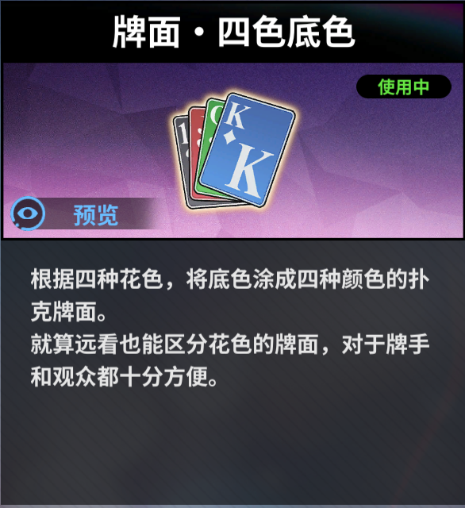

# 德扑助手

Windows 本地德扑牌桌识别工具。读取筹码、下注、底池、大小盲、手牌和公牌，在左下角显示动作建议与 EV。

目前为早期版本，框选区域等功能尚未验证，可能出现无法识别或误读。游戏或助手位于前台时，A/Q 用作快捷键，可能影响正常输入。尽可能最大化Poker Fate窗口。识别结果与建议仅供参考，请自行核对并判断是否适用。

**[下载安装包](https://github.com/Sleepearlyy/poker-screen-reader/releases/latest)**，双击 `.exe` 安装，从开始菜单打开“德扑助手”。

## 使用要求

- Windows 10/11 x64，无需 Python、Conda、CUDA 或独立显卡。
- **必须在游戏中使用「牌面·四色底色」**：红桃为红底、方块为蓝底、梅花为绿底、黑桃为灰黑底。其他牌面暂不支持。
- 适配 Poker Fate 当前牌桌布局，自己的座位在下方。少人局可以保留空座；其他布局需重新适配。
- 游戏保持可见、完整且无遮挡；不要最小化。缩放或移动窗口后，框选区域可能需要重新设置。



## 操作

1. 打开游戏和助手，默认自动寻找 Poker Fate 窗口；找不到时点击“框选区域”，框住完整游戏画面。
2. 轮到自己行动、手牌与按钮完整显示后，按 **A** 或点击“识别”。每次只识别一帧，牌局变化后需重新识别。
3. 按 **Q** 收起面板；点击“计算依据”查看范围假设。热键仅在游戏或助手位于前台时生效，打字时建议用鼠标按钮。

## 注意事项

- 识别前收起下注面板，等待发牌和筹码动画结束。面板、弹窗和其他窗口遮挡可能导致漏读或误读；请核对底池、手牌和待跟注金额。
- K/M 是游戏显示的近似金额，未显示的数据可能为未知。复杂主池/边池暂不完整支持。
- 多人建议使用蒙特卡洛与简化对手模型，**并非完整 GTO**；符合条件的单挑转牌/河牌使用 CFR。对手范围是假设，EV 以当前决定为起点、弃牌为 0，不含抽水或锦标赛 ICM。
- 截图与计算均在本机完成，不上传、不自动下注。设置和识别记录保存在 `%LOCALAPPDATA%\PokerScreenReader`，卸载后可手动删除。
- 安装程序未商业签名，Windows 可能显示“未知发布者”；请从本仓库 Releases 下载。

## 开发

Python 3.10/3.11、Rust stable 和 C++ 构建工具：

```powershell
pip install -r app/requirements.txt
cd app/solver
cargo build --release --locked
Copy-Item target/release/poker-engine.exe poker-engine.exe
cd ..
python popup.py
```

打包前安装 `packaging/requirements.txt` 中的依赖和 Inno Setup 6，在仓库根目录运行 `python packaging/build.py --iscc "C:\Program Files (x86)\Inno Setup 6\ISCC.exe"`。
源码及布局配置在 `app/`，安装包构建文件在 `packaging/`。

## 许可

[AGPL-3.0-or-later](LICENSE)。第三方声明见 [THIRD_PARTY_NOTICES.md](app/THIRD_PARTY_NOTICES.md)。与游戏官方无隶属关系。

## 免责声明

本项目仅供学习与技术研究，不保证识别准确、策略最优或盈利。使用者应自行判断结果，遵守所在地区法律及游戏平台规则，并承担使用风险。软件按现状提供，具体条款见 LICENSE。
